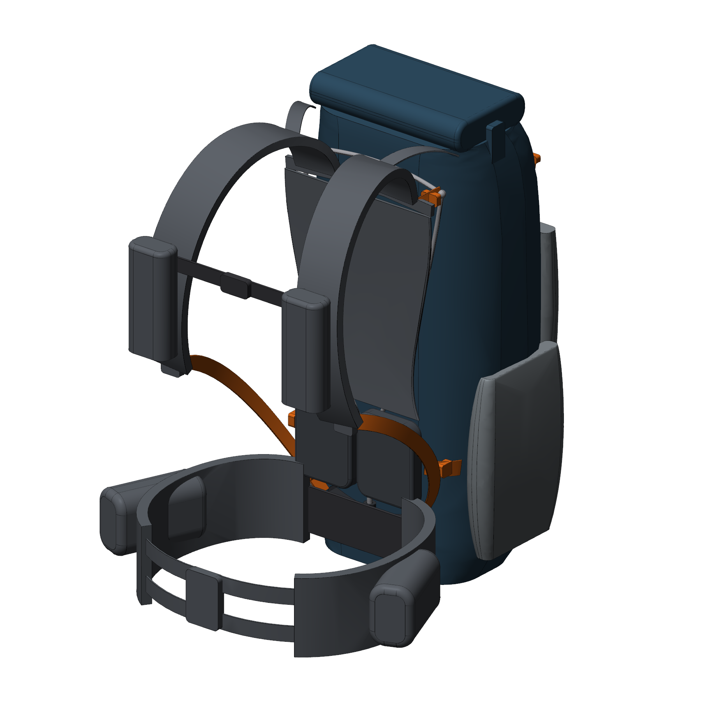

# -
户外的燃料

## 项目：40 L 随动背负系统背包（对标 Aarn Pace Magic 40）

| 文档 | 内容 |
|---|---|
| [docs/01 竞品调研](docs/01_benchmark_research.md) | Aarn Pace Magic 40 参数、背部原理（X 杆悬浮网、U-Flow 联动、双织带腰带、前置平衡） |
| [docs/02 专利检索与规避](docs/02_patent_landscape.md) | Aarn 专利族及状态（无中国同族、核心专利已过期）、现有技术、风险清单 |
| [docs/03 改版设计方案](docs/03_redesign_spec.md) | 我们的 5 个创新点、外观区别、BOM、原型/手办计划 |
| [docs/04 申请策略与材料清单](docs/04_filing_strategy_and_checklist.md) | 需要交什么（不需要交手办和带尺寸的工程图）、1 发明 + 1 实用新型 + 3 外观的组合方案 |
| [patent/A 发明/实用新型](patent/A_invention_linkage_harness/) | 权利要求书（16 项）、说明书、摘要初稿 |
| [patent/C、D、E 外观设计](patent/) | 整包、局部（背负系统）、联动座的简要说明 |
| [cad/](cad/README.md) | 参数化 3D 模型、STEP/STL、专利附图、外观视图、A3 工程图（含 DXF） |

> 所有专利文本均为 **初稿**，递交前须经专利代理师检索并定稿。产品与样品在申请递交前不要公开。
