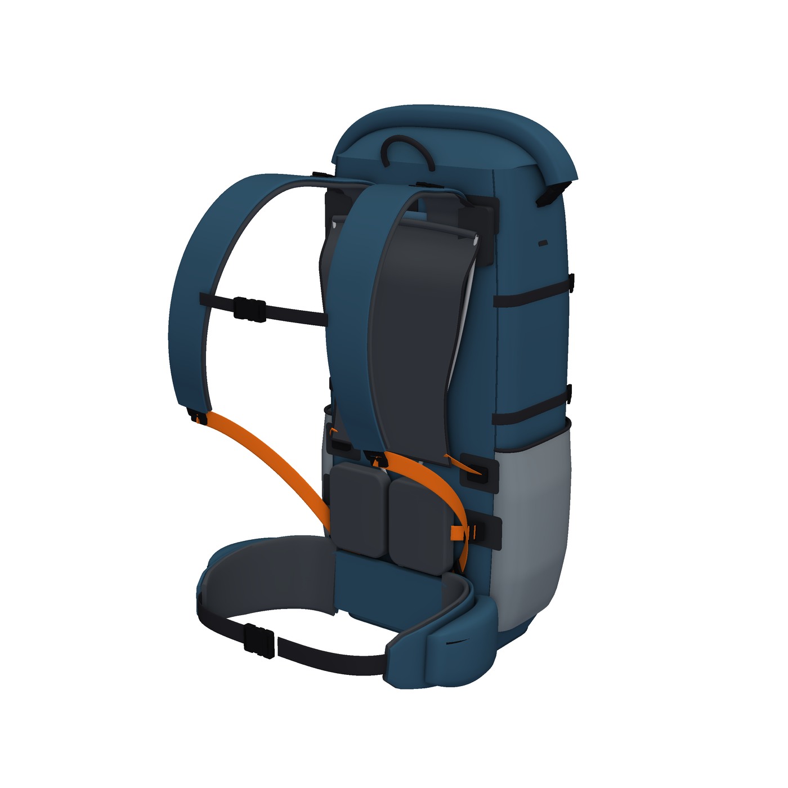

# -
户外的燃料

## 项目：40 L 随动背负系统背包（对标 Aarn Pace Magic 40）

| A1 预览（按生产裁片装配） | A0 概念模型（专利附图用） |
|---|---|
|  |  |

| 文档 | 内容 |
|---|---|
| [docs/01 竞品调研](docs/01_benchmark_research.md) | Aarn Pace Magic 40 参数、背部原理（X 杆悬浮网、U-Flow 联动、双织带腰带、前置平衡） |
| [docs/02 专利检索与规避](docs/02_patent_landscape.md) | Aarn 专利族及状态（无中国同族、核心专利已过期）、现有技术、风险清单；第 4 节是补充检索：CN2800884Y 已公开"滚轮联动 + 锁止"，权利要求 1 需要重写 |
| [docs/03 改版设计方案](docs/03_redesign_spec.md) | 我们的 5 个创新点、外观区别、BOM、原型/手办计划 |
| [docs/04 申请策略与材料清单](docs/04_filing_strategy_and_checklist.md) | 需要交什么（不需要交手办和带尺寸的工程图）、1 发明 + 1 实用新型 + 3 外观的组合方案 |
| [docs/05 对标款逆向重建](docs/05_reverse_engineering_pm40.md) | Aarn PM40 近似 3D 模型（照片标定，非原厂文件）、细节模型（63 种零件，含内部结构、五金件、剖切图、爆炸图、BOM）、测量表、精度与使用边界 |
| [docs/06 品牌背负结构调研](docs/06_brand_suspension_survey.md) | Mystery Ranch、Osprey、Deuter、Gregory、凯乐石的背负系统，随动背负的同类产品，相关专利及法律状态，可借鉴的通用做法 |
| [docs/07 公开 CAD 与纸样资源](docs/07_public_cad_and_patterns.md) | 结论：没有任何品牌公开生产用 CAD 或纸样；可合法使用的五金规格、开源纸样、中国和国际标准、工厂接受的文件格式 |
| [docs/08 A1 量产资料包](docs/08_production_package_A1.md) | 我们自己的 32 种裁片（DXF、1:1 PDF、排料图）、物料和五金清单、缝制工序、尺寸表、检验要求。首版样包用，还没有经过打样验证。第 12 节是按裁片装配的 3D 预览，另有可在手机上操作的交互网页（[viewer/](viewer/index.html)） |
| [patent/A 发明/实用新型](patent/A_invention_linkage_harness/) | 权利要求书（16 项）、说明书、摘要初稿 |
| [patent/C、D、E 外观设计](patent/) | 整包、局部（背负系统）、联动座的简要说明 |
| [cad/](cad/README.md) | 参数化 3D 模型、STEP/STL、专利附图、外观视图、A3 工程图（含 DXF）、生产用裁片（`cad/out/production/`） |

> 所有专利文本均为 **初稿**，递交前须经专利代理师检索并定稿。产品与样品在申请递交前不要公开。
