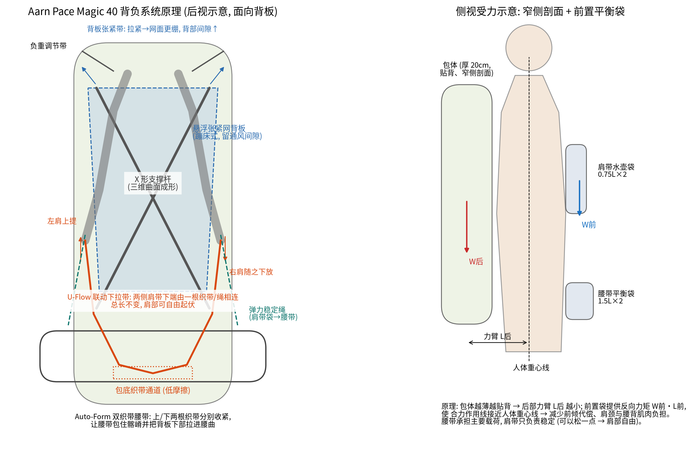

# 01 竞品调研：Aarn Pace Magic 40 背包

> 资料来源：Aarn 官网（2026-11-09 抓取）、官网商品数据接口、官网"Ergonomics & Fit / Movement / Balance Systems / Fitting Instructions"技术页面、Google Patents。
> 注意：用户给的链接 `.../products/pace-magic-40-backpack` 现在返回 404，当前商品页为 <https://www.aarnpacks.com/products/pace-magic-40-new>。

## 1. 产品基本信息

| 项目 | 参数 |
|---|---|
| 品牌 / 型号 | Aarn（新西兰）/ Pace Magic 40 |
| 定位 | 轻量徒步、快速轻装（Fastpacking）、朝圣路线、越野赛、一日到多日徒步 |
| 标价 | $349.00（官网显示，币种以结算页为准） |
| 产地 | 新西兰设计测试，越南制造 |
| 主面料 | 100D Robic（含 UHMWPE 的高强尼龙） |
| 底部 | 210D Duramax |
| 前袋 | Darlington 弹力网布 240 g |
| 外形尺寸 | 宽 27 × 深 20 × 高 66 cm |
| 容积 | 主仓 40 L + 腰带袋 2×1.5 L + 肩带前网袋 2×750 ml |
| 舒适负重 / 最大负重 | 12 kg / 13.5 kg |
| 自重 | 850 g |
| 背长 | 均码，可调 42–56 cm |
| 腰围 | 均码，75–117 cm |
| 配色 | 绿色主体，Blue Accent / Red Accent 两种点缀 |

官方信息图标注的 14 个功能点：① 胸带（2 根，高度可调）② 负重调节带（Load lifters）③ 弹力稳定绳（Bungy stabilisers）④ 双调节 Auto-Form 腰带 ⑤ 肩带 ⑥ U-Flow 肩部背负系统 ⑦ 透气网面背板 ⑧ 背板张紧带 ⑨ 顶部拉链安全袋 ⑩ 前部压缩抽绳 ⑪ 冰镐/登山杖挂点 ⑫ 1.5 L 腰带袋 ×2 ⑬ 750 ml 网袋 ×2 ⑭ Lasso Loc 挂扣 ×12。

## 2. 背部原理（核心）

Aarn 的设计思路有三条：**平衡（Balance）、自由活动（Movement）、贴合（Fit）**。落到 Pace Magic 40 的背部，有以下 5 个机构。

### 2.1 X 形支撑杆 + 悬浮张紧网背板（"蹦床"式背板）

- 从产品后视图可以透过网面看到背板后面有 **X 形交叉的弯曲支撑杆**。官网说明：小容量包使用 "curved X-stays" 形成三维造型，大容量包使用"沙漏形周边框 + 水平横杆"。
- 支撑杆做出两种曲线：
  - 竖向的 **S 形曲线**，贴合脊柱生理弯曲；
  - 横向的 **内凹曲线**，让包"抱"住背部，同时让包的侧剖面很窄（所以从后面看包显大、从侧面看很薄）。
- 网面背板 **悬空张在支撑杆前方**，与包体之间留出通风间隙，背负时像蹦床一样随背型变形（官方叫 "Auto-Mould"）。
- 背板上方有 **张紧带（⑧）**：拉紧时网面更绷，背部与包体的间隙变大；放松则更贴背。

### 2.2 U-Flow 联动下拉带（肩部自由活动）

这是 Aarn 最有辨识度、也申请过专利的机构（US2006/0131355A1，"Backpack with shoulder movement harness system"）：

- 左右肩带的 **下端不是各自固定在包上**，而是用 **一根低摩擦织带/绳连起来**，这根带子从包底部的通道（两层面料之间的"套管"或 U 形低摩擦管）里穿过。
- 走路时两肩一上一下交替起伏：左肩抬起，带子在通道里滑动，右侧肩带下端被同步放下。**两侧总长不变，所以包不会松垮，但肩膀不会被锁死。**
- 官方称这能减少肩颈疲劳，在扭转、侧弯、前屈时包仍"贴"在背上。
- 大包上还有同类的"联动侧连接"（腰带两侧通过穿过 U 形管的绳相连）和"联动顶部稳定带"。

### 2.3 Auto-Form 双织带腰带

- 腰带两侧各有 **上、下两根收紧织带**，通过同一个织带环汇到一个拉手上。
- 上下松紧可以分别调：让腰带包住 **髂嵴**（骨盆上缘），把载荷落在骨骼上而不是肌肉上；同时把 **背板下部拉进腰椎前凸处**，给腰部支撑。
- 小包（Daypack 类）的背板下部做成可弯曲的，人前倾时下部随之弯折（"前向枢转"）。

### 2.4 前置平衡袋（Balance）

- 肩带上的 750 ml 弹力网袋、腰带上的 1.5 L 袋，把一部分重量放在身体前面，与背后的包形成 **反向力矩**，让合力作用线靠近人体重心线，减少身体前倾和腰背代偿。
- 窄侧剖面（包体深 20 cm）进一步缩短后部力臂。
- 官方观点：总负重 > 6 kg 时，平衡带来的省力足以抵消多出来的系统重量。

### 2.5 弹力稳定绳 / 负重调节带 / 双胸带

- 弹力稳定绳（③）把肩带前袋与腰带相连，允许小幅弹性位移而不晃动。
- 负重调节带把包顶部拉向肩带，控制上部与背部的距离。
- 两根胸带高度可调，适配不同胸型。

### 2.6 小结：它为什么"背起来像没背"

1. **载荷路径**：包体 → X 杆/背板 → 腰带（髂嵴），肩带主要负责稳定，可以背得比较松。
2. **力矩平衡**：窄侧剖面 + 前置袋，减小背后载荷对身体的倾覆力矩。
3. **运动解耦**：U-Flow 让肩、髋相对包体自由活动，而包相对躯干保持稳定。
4. **自适应贴合**：张紧网 + 可冷弯的杆 + 双织带腰带，适配不同背型。

## 3. 对我们的启示

| Aarn 做法 | 局限 / 可改进点 | 我们的改版方向（见 03 文档） |
|---|---|---|
| 织带在面料通道或 U 形管内滑动（滑动摩擦） | 摩擦随载荷、潮湿、泥沙增大；面料通道易磨损；没有回中力，包容易偏到一侧 | 刚性联动座 + 双滚轮（滚动摩擦）+ 回中弹性件 + 行程限位 |
| 联动常开，只能靠拉紧腰带联动绳来"减少"活动 | 爬坡、乱石、下坡跑时用户希望包完全固定 | 加凸轮锁止：自由/锁止一键切换 |
| X 杆 + 单区张紧网 | 网面张力只能整体调，腰部贴合与背部通风互相牵制 | Y 型背架 + 上下两区独立张紧（上区悬浮网、下区分体腰垫） |
| 腰带靠弹性连接 / 背板弯折实现前倾 | 没有绕前后轴的"髋部侧摆"自由度 | 腰带背板通过枢转盘装在同一个联动座上，可侧摆 |
| 绿色 + 灰色网布、前部 X 形压缩绳 | 外观需要明显区别，否则外观专利不具备新颖性/明显区别 | 卷口包体 + V 形压缩绳 + 倒梯形前袋 + 新的背部造型 |

## 4. 建议的下一步调研

- **买一个实物拆解**（约 $349）。照片只能看到外部，内部织带走向、通道结构、杆的截面和材料需要实物确认。购买并研究公开销售的产品是合法的。
- 用测力计对比：同样 10 kg 载荷下，原版与我们原型的肩部压力、肩带滑动阻力、背部间隙。
- 收集用户评价（BackpackingLight、Reddit r/Ultralight、YouTube 测评）中的痛点，作为说明书"背景技术"里"现有技术缺陷"的佐证。
