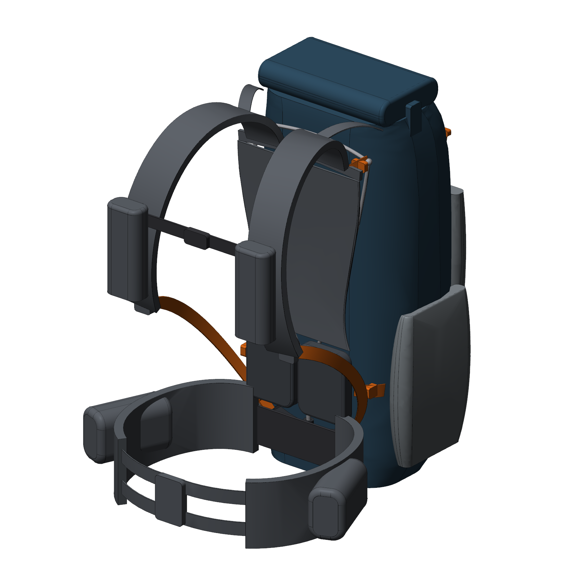
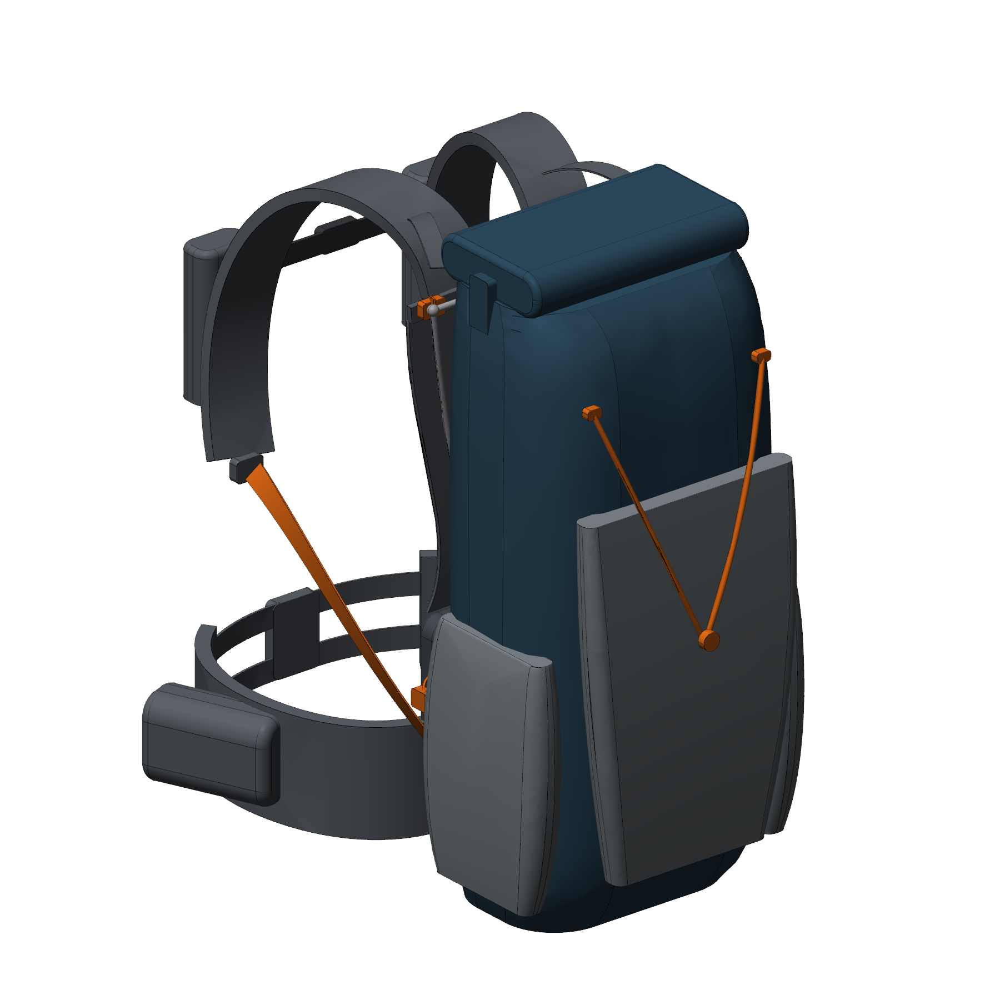
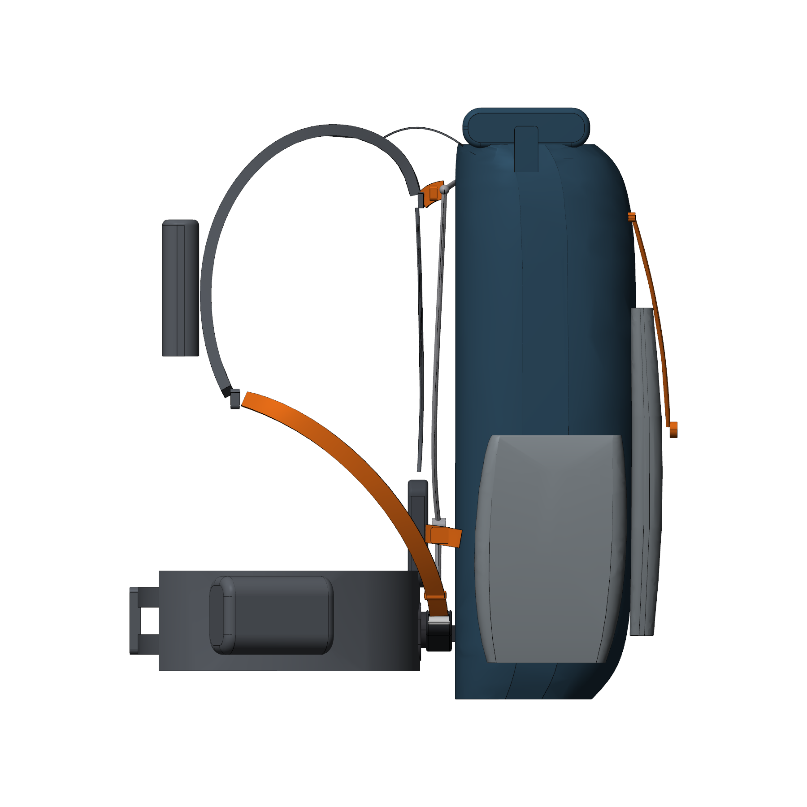
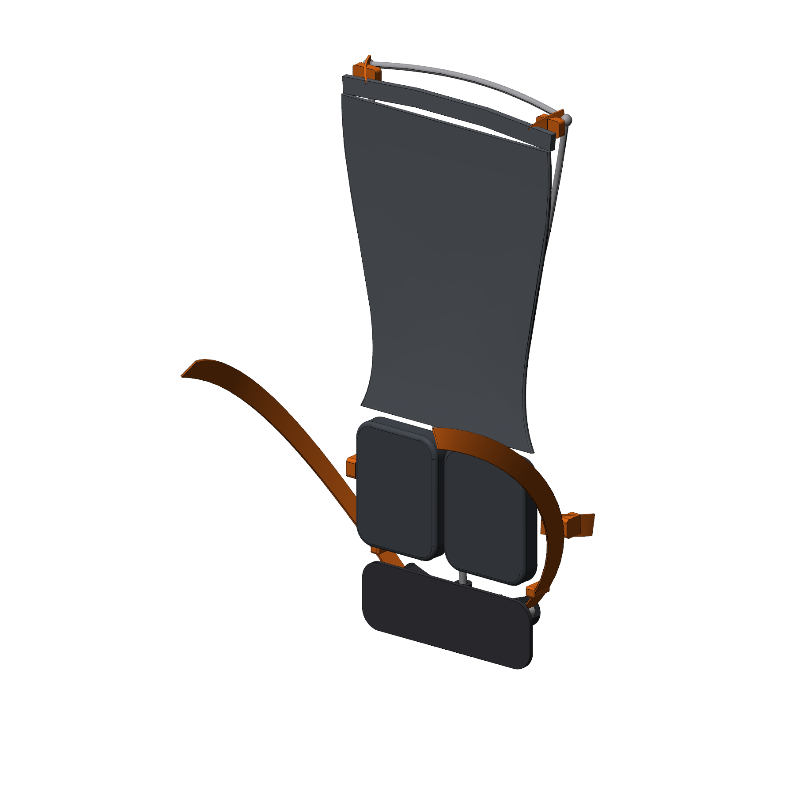
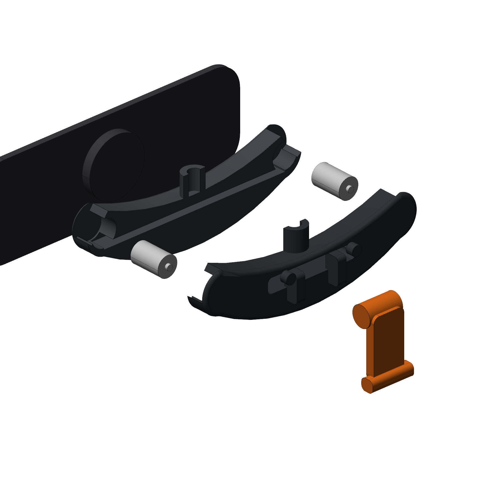
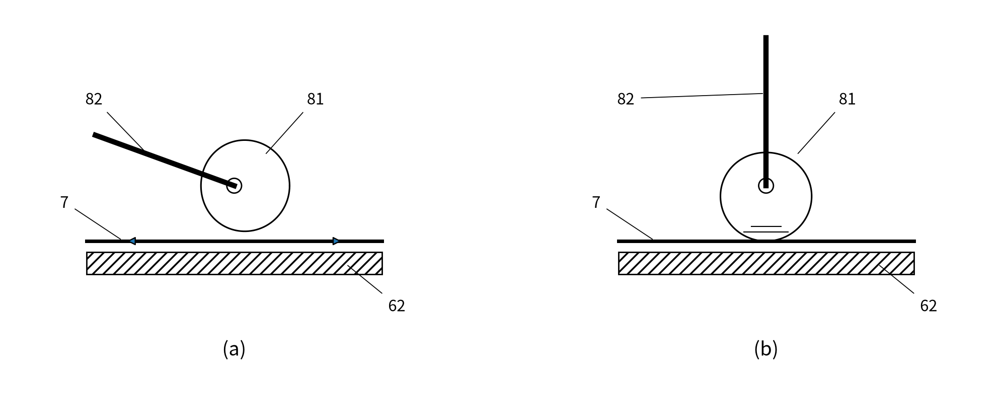
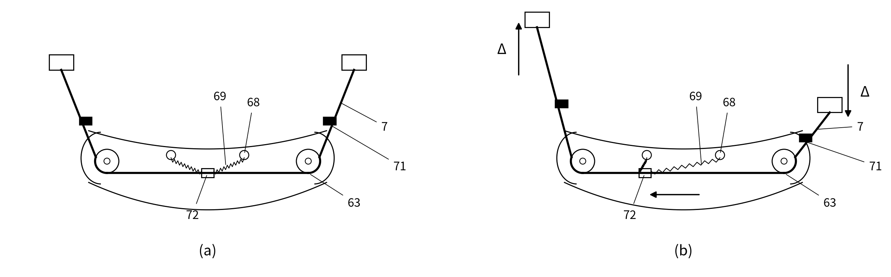
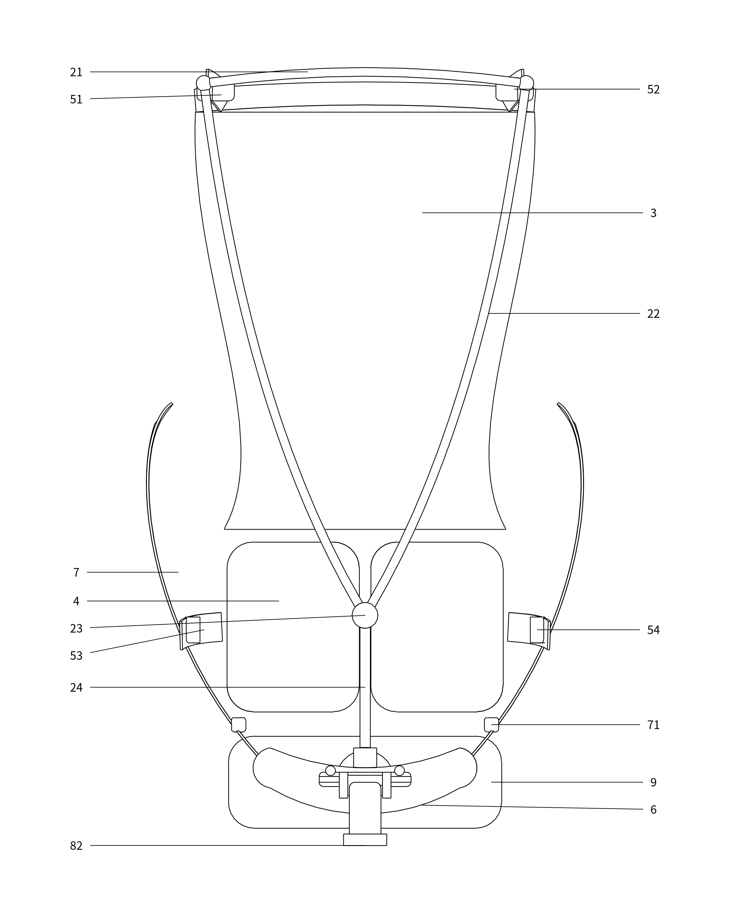

# 03 改版设计方案："随动背负系统" 40 L 背包（概念 A0 版）

目标：保留对标款"负重落在髋部、肩部自由活动、背部通风贴合"的使用体验，同时在 **结构原理和外观上都与 Aarn 明显不同**，形成我们自己可以申请专利的技术方案。

| 正面立体 | 侧视 | 背负系统（去掉包体） |
|---|---|---|
|  |  |  |

## 1. 总体参数（与对标款同级）

| 项目 | 设定值 |
|---|---|
| 容积 | 主仓约 40 L（卷口式），前弹力袋 + 两侧袋 + 腰带袋 2 个 + 肩带水壶袋 2 个 |
| 外形 | 宽 28 × 深 20 × 高 64 cm（含卷口 65 cm） |
| 目标自重 | ≤ 950 g（联动座组件约 60–80 g，Y 型背架约 120 g） |
| 舒适负重 | 12 kg |
| 背长 | 42–56 cm（肩带上端在背架上横梁处做梯形可调，A1 版细化） |
| 腰围 | 75–120 cm |

坐标约定（CAD 模型同此）：X 为左右，Y = 0 为背板贴身面，+Y 指向包体，Z 向上，Z = 0 为包底。

## 2. 五个创新点（专利保护重点）

### 创新点 1：滚轮式肩带联动座（核心）

- 包底背侧中央固定一个刚性 **联动座（6）**，前视轮廓呈两端上翘的"微笑"弧形（宽 156 × 高 46 × 厚 28 mm）。
- 座内两端各装一个 **Ø14 POM 滚轮（63）**，中间是 **导向通道（65）**。一根 20 mm 宽的光滑扁织带（UHMWPE）作为 **联动带（7）**：穿过通道，绕过两个滚轮，从两端斜向上的 **出带口（66）** 伸出，接到左右肩带下端。
- 走路时左肩上提 Δ，联动带在座内滚动滑移，右肩带下端同步下放 Δ，两侧总长不变。
- 与 Aarn 的区别：Aarn 是织带在面料通道/U 形管里 **滑动**；我们是在刚性座内绕滚轮 **滚动**，摩擦小且不受面料磨损、受潮、进沙影响。出带角度由座体上翘端固定，不随背长变化而改变包角。

### 创新点 2：可切换锁止（自由 / 锁止）

- 联动座朝包体一侧装有 **偏心凸轮（81）+ 扳手（82）**。扳手放下是释放位置，联动带可自由滑动；扳手抬起时，凸轮把联动带压在后壳（62）壁面上，联动带被固定，背包变成传统的"刚性"背负。
- 使用场景：平路、长距离走用"自由"模式；攀爬乱石、下坡跑、过窄桥用"锁止"模式。
- 可选：扳手接一根拉索引到腰带拉手上，背着包也能单手切换（从属权利要求）。

### 创新点 3：回中弹性件 + 行程限位

- 联动带中段固定一个 **中位件（72）**，两侧各用一段弹性绳（69）连到联动座上的 **锚柱（68）**。联动带偏离中位时，弹性绳产生与偏移量近似成正比的回复力：包不会长期偏向一侧，放下包后肩带自动回到对称位置。
- 联动带两伸出段各有一个 **限位块（71）**，尺寸大于出带口，把单侧行程限制在约 ±35 mm 内，防止大幅度侧倾时一侧肩带"放空"。

### 创新点 4：Y 型背架 + 上下双区独立张紧背板

- **Y 型背架（2）**：上横梁（21）横向内凹；两侧臂（22）呈 S 形，向下汇合于节点（23）；节点下接单根下立杆（24），插入联动座的插座（67）。
  - 与 Aarn 的 X 杆、沙漏形周边框不同：上部两臂给横向稳定，下部单杆可以绕自身轴线做小幅扭转，像扭杆一样允许髋部与肩部反向转动，同时把载荷集中传到联动座/腰带中心。
- **上区**：悬浮 3D 网面（3）张在背架上部，与包体之间留约 30 mm 通风间隙，上区张紧带（51）+ 凸轮扣（52）调张力。
- **下区**：腰垫（4）左右分两块，中间留竖向通风槽（41）；下区张紧带（53）+ 扣具（54）把腰垫拉向腰椎前凸处。
- 两区张力 **相互独立**：可以背部留大间隙通风，同时腰部压实支撑。Aarn 只有一组张紧带调整个网面。

### 创新点 5：腰带同轴枢转

- 联动座贴身侧有 **枢转盘（91）**，腰带背板（92）通过枢转盘与联动座转动连接，转轴沿前后方向（Y 轴）。腰带可在冠状面内左右摆动约 ±8°（髋部侧摆，走路时一侧髋上提），背架不跟着晃。
- 所有"运动自由度"（肩部联动、锁止、髋部侧摆、背架插接）都集中在 **一个注塑件组合** 上：方便量产和装配，也让专利更容易做成"结构组合"的保护范围。

## 3. 外观设计要点（外观专利保护重点）

与 Aarn 明显区分，避免被认定为近似设计：

| 部位 | 我们的设计 | 对标款 |
|---|---|---|
| 顶部 | 卷口式顶部 + 两侧插扣 | 顶部拉链袋 + 卷口 |
| 正面 | 倒梯形弹力前袋，袋上方两根 **V 形压缩绳** 汇于中心挂扣 | 灰色网面前袋 + 前部 X 形抽绳 |
| 侧面 | 上收下放的侧袋 | 大侧袋 |
| 背部 | Y 型背架 + 沙漏形上区网面 + 分体双腰垫 + "微笑"弧形联动座 | X 杆 + 整片网面 |
| 配色建议 | 深蓝灰包体 + 橙色功能件（联动带、张紧带、扳手） | 绿色主体 + 灰色网布 |

外观专利图（线条图）见 `cad/out/design/`：
- `01_backpack_whole/`：整体，6 个视图 + 立体图
- `02_backpack_partial_back_system/`：局部外观设计，实线为要求保护的背负系统，虚线为不保护的其余部分
- `03_linkage_hub/`：联动座单独作为配件申请

## 4. 物料清单（BOM，A0 概念）

| 编号 | 零件 | 材料 / 工艺 | 关键尺寸 | 数量 |
|---|---|---|---|---|
| 61/62 | 联动座前壳 / 后壳 | PA66-GF30 注塑，超声焊或 4×M3 自攻 | 156×46×28 | 1 套 |
| 63 | 滚轮 | POM，Ra ≤ 0.8 | Ø14×22，内孔 Ø4 | 2 |
| 64 | 滚轮轴 | SUS304 销 | Ø4×26 | 2 |
| 81/82 | 凸轮 / 扳手 | PA66-GF30（凸轮面可包胶 TPU 增摩） | 凸轮 Ø14，扳手 22×40 | 1 |
| 91/92 | 枢转盘 / 腰带背板 | PA66 + 0.8 mm HDPE 板 | 盘 Ø40；板 190×64 R18 | 1 |
| 2 | Y 型背架 | 7075-T6 Ø6 实心杆（下立杆 Ø7）+ 铝 Y 型三通接头 | 宽 224，高约 470 | 1 |
| 7 | 联动带 | 20 mm UHMWPE 扁织带，表面压光 | 长约 900 | 1 |
| 69/72 | 回中弹性绳 / 中位件 | 3 mm 弹力绳 / PA 夹片 | — | 2 / 1 |
| 71 | 限位块 | PA 卡扣，带锁紧齿 | 10×24×10 | 2 |
| 3 | 上区悬浮网 | 3D 间隔网布 + 包边 | 宽 176–236 | 1 |
| 4 | 腰垫 | EVA 发泡 + 3D 网布包覆 | 92×118×22 ×2 | 1 套 |
| 51–54 | 双区张紧带及扣具 | 20 mm 尼龙织带 + 凸轮扣 / 插扣 | — | 各 2 |
| 1 | 包体 | 100–210D 高强尼龙（如 UHMWPE 格子布） | 28×20×64 cm | 1 |

工程图：`cad/out/drawings/BP40-HUB-001_linkage_hub.pdf`（联动座三视图 + 技术要求 + 标题栏，另附 DXF）、`BP40-FRM-001_y_frame.pdf`（背架两视图 + 折弯点坐标）。

## 5. 原型与"手办"计划

| 阶段 | 内容 | 用到的文件 |
|---|---|---|
| P0 展示模型（手办） | 整包 1:4 缩比模型，光固化/SLA 打印后喷涂，用于内部评审和外观定稿 | `cad/out/stl/backpack_scale_1to4.stl` |
| P1 功能件 1:1 | 联动座前/后壳 FDM（PETG）或 SLS（PA12）打印；滚轮用 POM 棒车削或打印；Ø4 销 | `hub_front_shell_1to1.stl`、`hub_rear_shell_1to1.stl`、`rollers_1to1.stl`、`cam_lever_1to1.stl`、`pivot_plate_1to1.stl` |
| P2 改装验证机 | 买一款普通 40 L 背包，拆掉肩带下端固定点，装上 P1 联动座和联动带，先验证滚动阻力、回中、锁止 | 同上 + 织带 |
| P3 完整样包 | 交箱包打样厂（东莞、泉州、厦门等箱包产业带），需要补充 **2D 纸样（裁片图）** 和工艺单 | STEP 总装 + 本文档 |

> 注意：**样品、样包在专利申请提交之前不要对外展示或销售**。打样厂签保密协议。

## 6. 待验证 / 待细化

- 联动带滚动阻力目标：10 kg 载荷下单侧拉动力 < 5 N（Aarn 方案需实测对比）。
- 回中弹性绳刚度：建议 0.1–0.3 N/mm，样机上试 3 档。
- 锁止保持力：联动带在锁止状态下承受 ≥ 150 N 不滑移。
- 背长调节结构（肩带上端）在 A1 版设计。
- 软件模型中软包体是简化曲面，最终外观以样包照片或定稿 CAD 为准。
