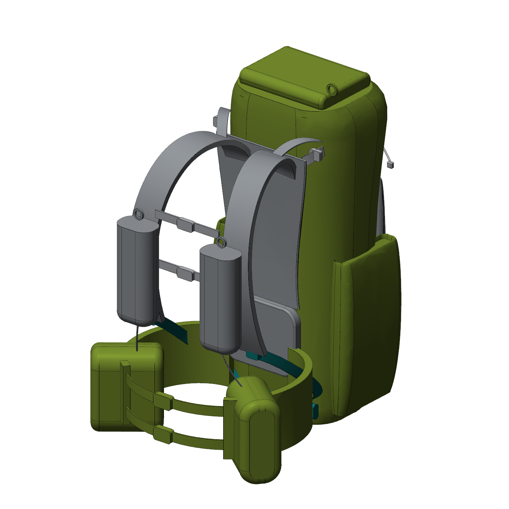
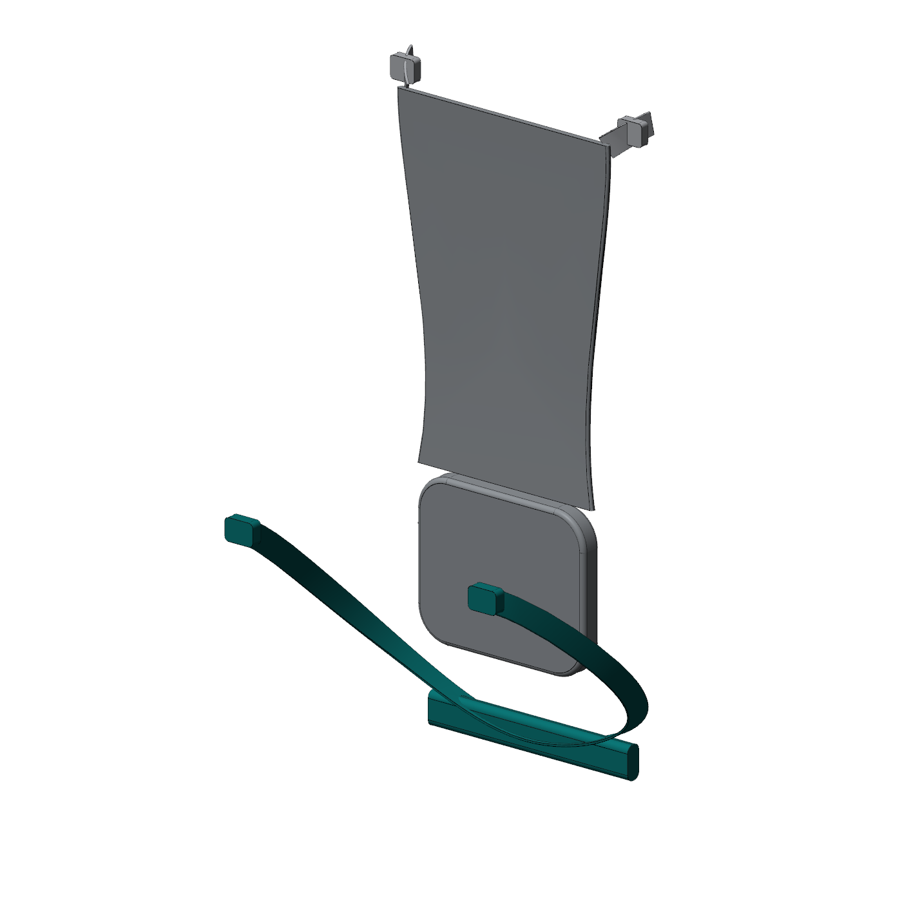
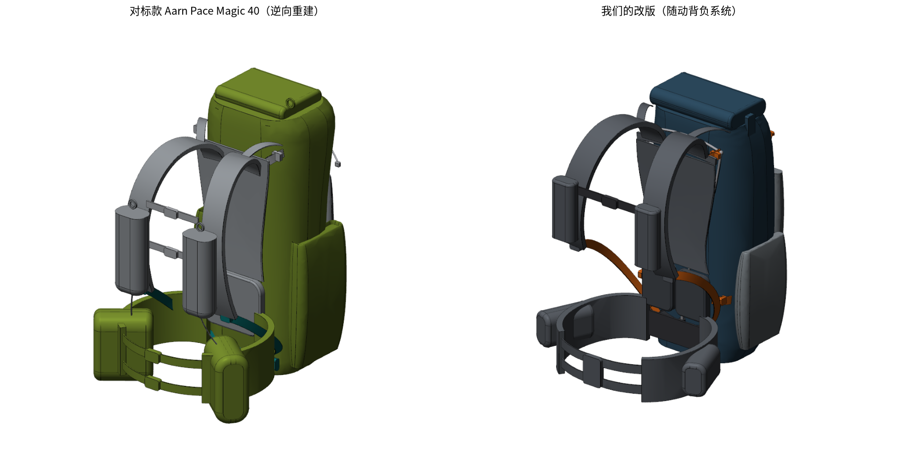

# 05 逆向重建：Aarn Pace Magic 40 近似 3D 模型

> **这不是 Aarn 的原厂 CAD 文件。** 原厂文件属于对方的内部资料，拿不到，也不应该去获取。本模型是根据官网公开照片和公布参数 **逆向重建的近似模型**，只用于对标分析：结构理解、尺寸对比、和我们改版方案的差异展示。

## 1. 方法

1. 从官网下载 11 张商品照片（1200×1200）。用正后方（pm40_01）和正侧方（pm40_03）两张做测量，其余照片用来看细节和结构。
2. 去掉白色背景，得到产品剪影；侧面照先旋转 5.6°，让背板变成竖直线。
3. **标定比例尺：**
   - 侧面照：以官方高度 66 cm 为基准，得到 0.609 mm/像素；
   - 背面照：水平方向以官方宽度 27 cm 为基准，得到 0.53 mm/像素；竖直方向用腰包上沿、顶部横带这两处和侧面照对齐，得到 0.625 mm/像素（两个方向不一致，是透视造成的）。
4. **交叉校验：**侧面照测得包体中段深度 202–209 mm（官方 200 mm），误差小于 5%。
5. **逐行测量：**侧面照每 20–25 像素量一次包体的前、后边缘，背面照量一次左右边缘（侧袋和包体分开量）。数据直接写在 `cad/benchmark_aarn_pm40.py` 的 `SIDE_FRONT`、`SIDE_BACK`、`REAR_HALF_W`、`SIDE_POCKET_HALF_W` 表里，可以追溯。
6. **建模：**包体用 20 个截面放样，截面是后部偏平、前部偏圆的超椭圆。侧袋、前网袋、水壶袋、腰包也都用同样的软体截面放样。肩带、调节带、U-Flow 织带按两张照片量出的三维路径扫掠。
7. **客观检验：**把模型投影成剪影，按上面的标定参数直接叠到照片上，计算和照片剪影的交并比（IoU，1.0 表示完全重合）。

| 版本 | 侧面 IoU | 背面 IoU |
|---|---|---|
| 第一版（手工估计 7 个截面） | 0.57 | 0.79 |
| **当前版（逐行测量）** | **0.82** | **0.92** |

剩下的差异主要有三处：照片里松垂的织带尾巴和抽绳（模型里没有），面料褶皱，腰带在照片里是下垂状态。

8. 照片看不到的内部结构，包括杆的截面、杆端位置和包底织带走向，按 Aarn 官网技术说明和它的专利文献（US2006/0131355A1、EP0748599B1）推断。

## 2. 测量结果

### 2.1 包体截面（Y 从背板面算起，向包体方向为正）

| Z（mm，自包底） | 半宽（mm） | 后表面 Y | 前表面 Y（含前网袋） | 深度 |
|---|---|---|---|---|
| 15 | 100 | 40 | 118 | 78（底部前缘大圆角） |
| 52 | 115 | 36 | 158 | 122 |
| 100 | 120 | 36 | 194 | 158 |
| 200 | 123 | 36 | 225 | 189 |
| 295 | 126 | 36 | 238 | 202 |
| 417 | 127 | 36 | 245 | 209（最深） |
| 515 | 134 | 36 | 238 | 202 |
| 563 | 135 | 2 | 229 | 227（顶部卷口向后鼓出背板） |
| 612 | 127 | −8 | 200 | 208 |
| 648 | 75 | 40 | 164 | 124 |
| 662 | 45 | 100 | 120 | 顶部拱顶 |

侧袋：Z 25–375，半宽 116–157 mm，最宽处在 Z≈360（比包体每侧多出约 30 mm）。

### 2.2 其他部件

| 部件 | 重建尺寸 / 位置 | 依据 | 可信度 |
|---|---|---|---|
| 肩带 | 宽 52 mm、厚 12 mm；倒 U 形，内端在 Z≈470、X≈±34 接入网面顶部，拱顶 Z≈519；胸前 X≈±56、Y≈−127；下端 Z≈182；外缘向胸侧包约 40°（背心式） | 背面照、侧面照、pm40_02 | 中高 |
| 肩带水壶袋 | 78×86×185 mm，中心 X±86、Y−168，Z 180–365 | 两张照片 + 官方 750 ml | 中高 |
| 胸带 | 2 根，Z≈324 / 214 | 背面照 | 中高 |
| 顶部调节带 | 从肩带拱外侧（Z≈508）到顶部横带两端（X±108，Z≈548） | 背面照局部放大 | 中 |
| 顶部张紧横带 | Z≈554，两端卡扣在 X±113 | 背面照 | 中高 |
| 悬浮网背板 | 浅色外网：Z 205–552，半宽 92–112；深色 Y 形中网：Z 209–512 | 背面照 | 中 |
| 腰垫 | 136×148 mm，Z 61–209 | 背面照 | 中 |
| X 形支撑杆 | Ø5 mm；上端 ±100 @Z548，下端 ±92 @Z165，在 Z≈370 处交叉（一前一后错开 6 mm） | 交叉段透过网面可见；端点为推断 | **低** |
| U-Flow 下端调节带 | 从肩带下端斜向拉到包体侧面中部（Y≈95，Z≈66），再进入包底套管左右相连 | 外露段：侧面照；**包内走向为推断** | 外露段中，包内**低** |
| 腰带 | 高 96 mm；照片里呈下垂的闭合环，背部中心 Z≈50，前扣 Z≈10、Y≈−290；前端为上下双织带 + 双扣 | 两张照片 | 中 |
| 腰包 | 约 116×176×193 mm 的软枕形，中心 X±88、Y−190，Z −50 至 143 | 两张照片 + 官方 1.5 L | 中高 |
| 前网袋 | Z 45–425，半宽 86–112，比包面鼓出约 10 mm | 侧面照、正面斜视照 | 中 |
| 前部压缩绳 | 4 个锚点（X±112，Z 470 / 545）汇到中部绳扣（Z≈430） | 正面斜视照 | 中 |

**整体精度：**外形主尺寸约 ±10 mm（受透视和面料鼓起影响）；部件位置约 ±10–15 mm；内部结构只是示意。

## 3. 输出文件（`cad/out/benchmark_aarn_pm40/`）

| 目录 | 内容 |
|---|---|
| `step/aarn_pm40_benchmark_assembly.step` | 带颜色的总装 STEP（16 个部件），可在 SolidWorks、Fusion 360、Creo 中打开 |
| `step/aarn_x_stays.step` | X 形支撑杆（推断） |
| `stl/aarn_pm40_scale_1to4.stl` | 1:4 缩比模型，可以打印出来，和我们的改版手办并排对比 |
| `render/` | 渲染图：正面斜视、背面斜视、后视、侧视；背负系统（去掉网面 / 带网面各一张） |
| `views/` | 六视图 + 立体图线条图（PDF / SVG / PNG） |
| `compare/` | 对标款与我们的改版对比 2 张。照片对比图（3 张）和剪影叠加检验图（2 张）里含 Aarn 官网照片，有版权，**不提交到仓库**，需要在本地带 `--photos` 参数生成 |

重新生成：`python3 cad/build_benchmark.py --photos <照片目录>`。运行后会打印两个视图的 IoU。照片不放进仓库，可以从官网重新下载，文件名按 `PHOTO_CAL` 里的写。

## 4. 如果要做到"工程级"精度

照片逆向的上限大致就是上面的精度。要做到能指导打样的程度，需要实物：

1. **买一个实物**（官网约 $349），这是合法的竞品研究方式。
2. **3D 扫描**：用手持结构光扫描仪（例如 EinScan、Revopoint）扫外形。背包要先装填到标准状态（按 40 L 填充软泡沫）再扫，误差可以到 ±1 mm 级。
3. **拆解测量**：拆开背板取出支撑杆，量截面、长度和弯曲半径；拆开包底，确认 U-Flow 织带的通道结构；拆下裁片，描出 **纸样**（这才是软包"工程图"的真正形式）。
4. 把扫描点云导入 CAD（Geomagic Design X 或 SolidWorks 的 ScanTo3D），替换本模型里的近似曲面。

## 5. 使用边界

- 可以：用于对标分析、内部评审、尺寸对比，以及和我们的方案做差异论证（也可以作为向专利代理师说明"现有技术"的材料）。
- 不要：照这个模型直接生产同款或外观相近的产品；使用 Aarn 的商标、配色组合和产品名称；把这个模型或基于它的外观拿去申请专利。它是别人已经公开的设计，申请会被驳回或宣告无效，还可能引发不正当竞争纠纷。
- 我们申请专利、做产品，用的是 `cad/backpack_model.py` 里的改版设计。
