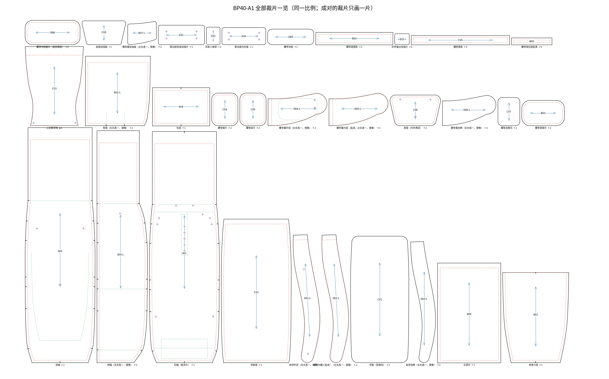
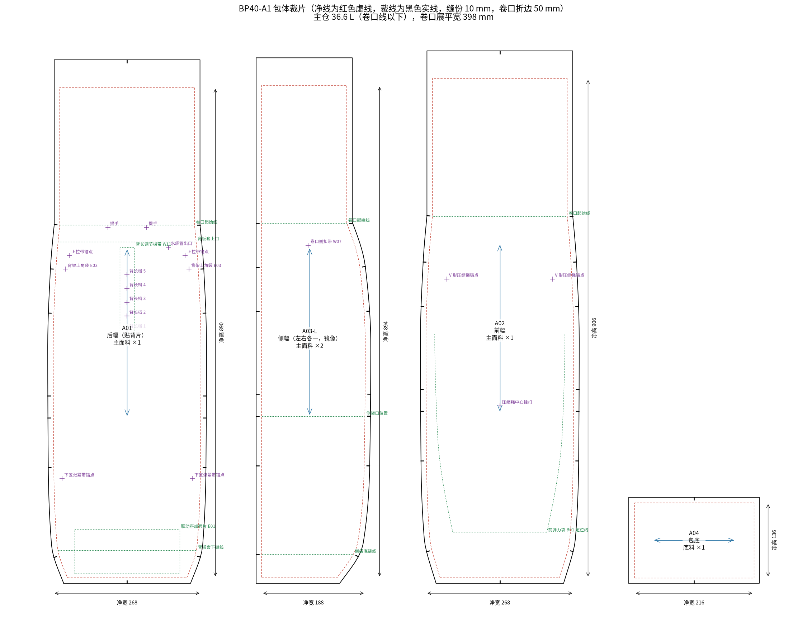

# 08 A1 量产资料包（首版样包用）

这是我们自己的 40 L 随动背负背包的第一版生产资料：全套裁片 CAD、物料和五金清单、缝制工序、尺寸表和检验要求。文件在 `cad/out/production/`，由 `cad/patterns.py` 和 `cad/build_patterns.py` 生成。



## 1. 这份资料能做什么，不能做什么

**能做什么**

- 交给箱包打样工作室或工厂版师，做第一版样包（P1）。裁片是 1:1 的 DXF 和 PDF，带缝份、刀口、纱向和定位线，裁床和纸格打印都能用。
- 作为和工厂沟通的基准：尺寸、物料、五金、工序都有编号，改版时按编号改。

**不能做什么**

- **不能直接量产。** 这套裁片是按几何关系算出来的，还没有缝过一个样包。软包的版型必须经过"打样 → 试背 → 改版"才能定稿，通常要两到三轮。
- 联动座和 Y 型背架的图纸（`cad/out/drawings/`）还是概念图：没有做注塑件的拔模、壁厚、加强筋设计，联动座的安装孔位也还没定。开模之前要先用 3D 打印件验证功能，再由模具厂做可制造性设计。
- 泡棉密度、面料克重、目标重量都是起点值，要用供应商的实际材料确认。

**来源**

全部裁片是自己画的，没有使用任何品牌的文件。Mystery Ranch、Osprey、Deuter、Gregory、凯乐石等品牌都没有公开过生产用 CAD 或纸样，网上带品牌名的 3D 模型都是爱好者自建的外观模型，不能用于生产，详见 [07](07_public_cad_and_patterns.md)。各品牌的结构是通过公开资料调研后，取其通用做法，见 [06](06_brand_suspension_survey.md)。

## 2. 参考各品牌后做的设计决定

A0 概念版（[03](03_redesign_spec.md)）只定了随动背负的原理。A1 按成熟品牌的通用做法补齐了一只 40 L 徒步包该有的结构：

| 通用做法 | 谁在用 | A1 的做法 | 对应裁片 / 零件 |
|---|---|---|---|
| 框架之外加一块防鼓包的背板 | Mystery Ranch、Gregory、Osprey Kestrel | 新增 1.5 mm HDPE 背板，插在包内的背板套里，可抽出 | C01、C02 |
| 框架下端直接落在腰带上 | Mystery Ranch、Osprey Atmos、Exped | 沿用 A0：Y 型背架下立杆插入联动座，联动座经枢转盘接腰带背板 | H13、H14、D09 |
| 上拉带锚在框架顶部有支撑的位置 | Mystery Ranch、Deuter | 锚点放在背板覆盖范围内（z = 585），加耐磨加强片 | A01 定位点、E02 |
| 背长可调，行程约 10 cm，有档位 | Osprey Exos、Deuter、凯乐石 | 肩轭 + 后幅梯带 + G 钩，5 档，档距 25 mm，行程 100 mm，梯带上印刻度 | C08、C09、W11、H07 |
| 载重 16 kg 以下用悬浮网通风 | Osprey AirSpeed、Deuter Aircomfort、Gregory、凯乐石风洞 | 沿用 A0 的上区悬浮网 + 下区分体腰垫 | C03、C04–C07 |
| 预成型腰带、双层结构、前拉收紧 | Osprey、Deuter、Mystery Ranch、Gregory | 腰带翼上弯 35 mm，10 mm 泡棉 + 1 mm 加强板，25 mm 织带前拉 | D04–D07、W05、H02、H08 |
| 腰带与框架之间留受控的活动量 | Deuter、Gregory、Lowe Alpine、Thule | 沿用 A0 的枢转盘，摆角约 ±8° | H13、D08、D09 |
| S 形肩带，泡棉 + 间隔网布，胸带可上下滑 | 各家通用 | 肩带垫长 486 mm，宽 50–70 mm，8 mm 泡棉，滑轨胸带 | D01–D03、W04、H06 |
| 面料分区：主体 100–210D，底部 400–500D，无氟防泼水 | Osprey、Gregory、Deuter、凯乐石 | 主体 210D，包底和联动座加强片 420D | M1、M2 |
| 通用一线辅料 | Mystery Ranch 用 YKK、Duraflex、Woojin | 清单里给出 YKK 目录型号作参考，可换同级 | 五金清单 |
| 设计阶段防异响 | Osprey、Mystery Ranch、Gregory 都被投诉过 | 背架杆端套胶帽，杆不直接接触背板 | H12、E03 |
| 水袋仓、腰带袋、前弹力袋、防雨罩 | 这个级别的标准配置 | 水袋仓、两个腰带袋、前弹力袋、两个侧袋；防雨罩外购选配 | B01–B06、H16 |
| 随动机构要能锁止、限行程、可更换 | Black Diamond 和 Exped 的随动背负被评测指出左右晃 | 沿用 A0 的凸轮锁止和 ±35 mm 限位；联动座改为螺钉安装，可拆换 | H13、H15、E01、E04 |

**主动避开的结构**（在美国或德国仍有有效专利，出口前要比对；清单见 [06](06_brand_suspension_survey.md) 第 7 节 (c)）：球铰式腰带连接、腰带在滑轨上滑动、腰带经柔性面板浮动连接、肩髋两个转动件反向耦合、3D 打印点阵腰垫。在中国有效、需要代理师看一眼的有 Coxa Carry、Moncreiff 和凯乐石的成型背板专利，我们的结构与它们不同。

## 3. A1 规格

| 项目 | 数值 | 说明 |
|---|---|---|
| 装满后外形 | 宽 300 × 厚 220 × 高 640 mm（到卷口线） | 比 A0 的 3D 模型各加大 20 mm |
| 主仓容积 | 36.6 L | 包底到卷口线，按圆角截面积分计算 |
| 标称容积 | 约 42 L | 主仓 36.6 + 前袋 2.4 + 侧袋 2.6 + 腰带袋 0.8；后三项是估算 |
| 扩展容积 | 约 +7 L | 卷口少卷时 |
| 估算重量 | 约 1.06 kg | 按假定克重计算，明细见 `weight_estimate.md` |
| 设计负重 | 舒适 12 kg | 与同级产品的 10–16 kg 区间一致 |
| 背长调节 | 行程 100 mm，5 档 | 具体适配的背长范围要在试背时量 |
| 腰带垫总长 | 666 mm | 适合腰围约 76 cm 以上；更小的腰围需要短一号腰带翼 |

**更正：** [03](03_redesign_spec.md) 里写"主仓约 40 L"，这个数不对。按 A0 的 3D 模型实际计算，主仓只有约 31 L。A1 把截面加大后主仓是 36.6 L，加上外袋才是约 42 L。成品的容积要在样包上用标准填充物实测。

**重量：** 估算 1.06 kg，高于 A0 定的 950 g 目标。最重的单项是 HDPE 背板（约 190 g）。减重的办法有：背板改 1.0 mm 或开减重孔，取消背板套上的水袋仓，泡棉换低密度。这些要在样包上试过刚度再定。

## 4. 文件清单

| 文件 | 内容 | 给谁用 |
|---|---|---|
| `dxf/pieces/BP40-A1_<编号>.dxf` | 每个裁片一个 DXF，32 个 | 版师导入箱包 CAD（ET、富怡、博克等）修改 |
| `dxf/BP40-A1_marker_<材料>.dxf` | 每种材料一张排料图 | 裁床、激光切割 |
| `pdf/BP40-A1_patterns_1to1.pdf` | 全部裁片 1:1，每页一片，带 100 mm 校准条 | 绘图仪打印纸格 |
| `pattern_overview.png`、`body_panels.png` | 裁片总览、包体四片带尺寸 | 沟通用 |
| `markers/marker_<材料>.png` | 排料示意和利用率 | 核算用料 |
| `cut_list.md` / `.csv` | 裁片清单：编号、材料、数量、外形、缝份 | 开料 |
| `edge_table.md` | 每条边的净长、缝份、做法、刀口数 | 版师、车位 |
| `seam_check.md` | 缝边对位校验结果 | 版师复核 |
| `webbing_cut_list.md`、`hardware_list.md` | 织带和五金清单 | 采购 |
| `material_usage.md`、`weight_estimate.md`、`volume.md`、`pom.md` | 用料、重量估算、容积、尺寸表 | 核价、验货 |

**DXF 约定：** 单位 mm，比例 1:1。图层：`CUT` 裁线（含缝份），`SEW` 净线（缝线位置），`NOTCH` 刀口，`GRAIN` 纱向（经向），`MARK` 定位线，`DRILL` 定位点，`TEXT` 文字。DXF 里的文字用英文（中文字体在各家 CAD 里容易乱码），中文名称见 `cut_list.md`。这不是严格的 DXF-AAMA 格式；如果工厂的软件要求 AAMA，图层对应关系是 CUT → 1，NOTCH → 4，GRAIN → 7，MARK → 8，DRILL → 13，SEW → 14，TEXT → 15。

**成对的裁片**（侧幅、侧袋、肩带、腰带翼）：清单里数量写 2，排料图里已经放了一正一反两片，编号后缀 `-L` 和 `-R`。

## 5. 裁片



共 32 种裁片、58 片，完整清单见 `cad/out/production/cut_list.md`。

| 组 | 裁片 | 说明 |
|---|---|---|
| A 包体 | A01 后幅、A02 前幅、A03 侧幅 ×2、A04 包底 | 四片筒身 + 包底。卷口线以上 250 mm 是卷口，顶边折 25 + 25 夹加强带 |
| B 外袋和内袋 | B01 前弹力袋、B02 侧袋 ×2、B03–B05 腰带袋、B06 水袋仓 | 侧袋下边打两个对褶，袋口穿松紧带 |
| C 背负系统 | C01 背板、C02 背板套、C03 悬浮网、C04–C07 腰垫、C08–C09 肩轭 | 背板可抽出；肩轭夹加强板，挂在后幅梯带上调背长 |
| D 肩带和腰带 | D01–D03 肩带三层、D04–D07 腰带翼四层、D08–D09 腰带中段 | 肩带、腰带翼三层合缝后包边 |
| E 加强件 | E01、E04 联动座安装加强片和内衬板，E02 锚点加强片，E03 背架上角袋 | E01 和 E04 一外一内夹住后幅 |

**缝份：** 包体缝 10 mm，缝合后用 20 mm 包边带包住；小件 8 mm；卷口折边 50 mm；肩带、腰带翼、悬浮网的外轮廓不留缝份，直接包边。每条边的做法见 `edge_table.md`。

**刀口：** 包体四条竖缝在 z = 40、200、290、330、480、560、640 mm 处两边都有刀口，缝合时对齐。其中 40 和 290 是侧袋的下边和袋口，330 和 480 是侧压缩带的位置，640 是卷口线。

**裁片是怎么得到的：** 先定装满后的截面（宽、厚、圆角半径随高度变化），缝线放在四个圆角的中点，所以各片的净宽加起来正好等于截面周长。后幅是平面；前幅沿侧面轮廓线展开；侧幅用三角形条带展开，展开前后每条边的长度不变（误差小于 0.01 mm）。这样相邻两片的缝边长度在几何上必然相等。

**自动校验：** 每次生成都会检查 16 组缝边（长度差不超过 0.5 mm，有设计吃量的按吃量算）、裁线是否包住净线、成对裁片数量、两侧刀口数是否一致。任何一项不过，脚本会报错退出。当前结果全部合格，见 `seam_check.md`。这只说明裁片之间对得上，不说明版型好看、好缝、好背，后者要靠样包。

## 6. 物料和五金

面料、泡棉、板材共 11 种，规格和单包用量见 `material_usage.md`；织带 17 项见 `webbing_cut_list.md`；五金 16 项见 `hardware_list.md`。

要点：

- 主面料单包约 1.35 m（幅宽 1.45 m，按外接矩形排料，利用率 67%）。工厂用排料软件套排后还能省一些。
- 五金清单里的 YKK 型号取自 YKK 公开目录，只作规格参考。定供应商后，向供应商要正式的 2D 图和拉力数据，再核对织带厚度是否匹配。
- 联动带用 20 mm 的 UHMWPE 压光扁织带，这是随动顺不顺的关键物料，要单独打样测滚动阻力。
- 泡棉密度（肩带约 60 kg/m³，腰带约 90 kg/m³）来自行业经验值，没有权威标准，样包上试过再定。

## 7. 缝制工序

线迹和线的写法参考了公开的美军背包采购规范 MIL-F-43832C 和行业常规，属于建议值，以工厂的工艺能力为准。

**通用要求**

- 线迹：单针平车锁式线迹（ISO 4915 的 301），每 3 cm 9–11 针。起止回针不少于 10 mm。
- 线：邦迪尼龙线 Tex 70（即 210D/3），机针 100–110 号。包边同线。
- 打枣：受力点一律打枣，长 12–16 mm，宽 3 mm，28–42 针。
- 包体内缝全部用 20 mm 包边带包住，不留毛边。
- 面料切边用热切或超声切，防止散边。

**受力点打枣清单：** 肩带上端与肩轭、肩带下端梯扣织带、上拉带两端、联动带与肩带下调节带的接头、腰带翼根部、腰带收紧带回折环、卷口插扣织带、侧压缩带两端、提手两端、背长调节梯带的每一档、上区和下区张紧带的锚点。

**工序**

| 序号 | 工序 | 涉及 |
|---|---|---|
| 1 | 开料：按排料图裁片，打刀口，点定位点 | 全部 |
| 2 | 后幅正面：缝背长调节梯带，每档打枣；贴 E02 加强片，缝上拉带锚点、下区张紧带锚点、提手；缝两个背架上角袋 | A01、W11、E02、E03、W03、W10、W12 |
| 3 | 后幅下部：E01 贴在正面，E04 放在反面，四周车缝固定，按孔位冲孔 | A01、E01、E04 |
| 4 | 背板套：上口卷边缝魔术贴；水袋仓上口卷边后三边缝到背板套上 | C02、B06、H11 |
| 5 | 背板套下边缝到后幅反面 z = 50 处，两侧先疏缝在后幅侧边缝份内 | A01、C02 |
| 6 | 前弹力袋：上口包弹力包边带，三边折入 10 mm，按定位线车明线缝到前幅上 | B01、A02 |
| 7 | 前幅：缝 V 形压缩绳锚点和中心挂扣 | A02、W13、H10 |
| 8 | 侧袋：上口卷边穿松紧带，下边打两个对褶，下边缝到侧幅 z = 40 横线上 | B02、A03、W17 |
| 9 | 侧幅：缝卷口侧扣带，侧压缩带在刀口处疏缝 | A03、W07、W08 |
| 10 | 合侧缝：后幅与两片侧幅缝合（夹入背板套侧边和侧袋后边），对齐刀口；再缝前幅与侧幅（夹入侧袋前边） | A01、A02、A03 |
| 11 | 四条竖缝包边 | W15 |
| 12 | 上包底：四边对齐中点刀口和四个角，缝合后包边 | A04 |
| 13 | 卷口：顶边折 25 + 25，夹入加强带车两道线，两端缝插扣 | W06、H01 |
| 14 | 肩带：外层、泡棉、内层三层对齐，沿边疏缝，包边；缝胸带滑轨、下端梯扣织带并打枣 | D01–D03、W02、W04、H03、H06 |
| 15 | 肩轭：两层夹加强板，缝合翻面；肩带上端插入 20 mm 车缝并打枣；背面缝带 G 钩的织带 | C08、C09、H07 |
| 16 | 腰带翼：外层先缝腰带袋（面片、围条、拉链），再与加强板、泡棉、内层合缝，包边；尖端缝收紧带回折环 | D04–D07、B03–B05、H08、H09 |
| 17 | 腰带中段：两层夹腰带背板，两端插入腰带翼根部 15 mm，车缝并打枣；中心冲枢转盘孔 | D08、D09 |
| 18 | 腰垫：面片与围条缝合，装泡棉，缝底片；缝下区张紧带 | C04–C07、W10 |
| 19 | 悬浮网：三边包边，上边折 35 mm 做横梁套管，下角缝上区张紧带 | C03、W09、H05 |
| 20 | 总装：Y 型背架杆端套胶帽，上横梁穿过悬浮网套管，两端插入背架上角袋；下立杆插入联动座 | H12、H14 |
| 21 | 联动座用 4 颗螺钉穿过 E01、后幅、E04 固定；腰带中段装到枢转盘上 | H13、H15 |
| 22 | 联动带穿过联动座，两端接肩带下调节带，装限位块和回中弹性绳 | W01、W02、W14 |
| 23 | 肩轭的 G 钩挂到梯带中间一档；装上拉带、胸带、腰带收紧带和中扣 | W03–W05、H02、H04 |
| 24 | 插入背板，检查线头、对称、各扣具开合 | C01 |

## 8. 成品尺寸表

完整表见 `cad/out/production/pom.md`，共 18 项。主要尺寸：

| 部位 | 尺寸 (mm) | 公差 (mm) |
|---|---|---|
| 包体高度（包底缝到卷口线） | 640 | ±8 |
| 后幅最大净宽 | 268 | ±5 |
| 侧幅最大净宽 | 188 | ±5 |
| 包底净尺寸 | 216 × 136 | ±4 |
| 卷口展平宽度 | 398 | ±5 |
| 肩带垫长 | 486 | ±5 |
| 腰带垫总长 | 666 | ±10 |
| 背长调节行程 | 100 | ±3 |

公差是软包常用的量级，量产前和工厂按他们的工艺能力确认。

## 9. 检验和测试

**合规底线：** QB/T 1333-2018《背提包》。按这份标准，容积大于 20 L 的双肩包振荡冲击只要求负重 6 kg、400 次，远低于 40 L 徒步包的实际使用负荷。所以它只能当底线，内控要另定更严的指标。下面引用的标准数值来自第三方转录，正式写进合同前请对照正版标准。

| 项目 | 底线（QB/T 1333-2018） | 建议内控（需和检测机构、工厂确认） |
|---|---|---|
| 振荡冲击（双肩带） | 6 kg，400 次 | 设计负重的 1.5 倍即 18 kg，次数加严 |
| 缝合强度 | 100 × 30 mm 上不低于 240 N | 肩带、腰带、联动带各接头单独做拉力，目标不低于 500 N |
| 拉链 | 开合 200 次无损坏；5 号尼龙拉链平拉不低于 600 N（QB/T 2173） | 同底线 |
| 塑料插扣耐用 | 1000 次（QB/T 5247） | 同底线，另加低温开合 |
| 摩擦色牢度 | 干擦不低于 3–4 级，湿擦不低于 2–3 级 | 同底线 |
| 有害物质 | 偶氮不超过 30 mg/kg，甲醛不超过 300 mg/kg | 出口欧美另查 PFAS、REACH |

**随动机构专项**（沿用 [03](03_redesign_spec.md) 第 6 节的目标）：

- 滚动阻力：10 kg 负载下单侧拉动力小于 5 N。
- 锁止保持力：锁止状态下联动带承受 150 N 以上不滑移。
- 行程：单侧 ±35 mm，限位块不脱出。
- 耐久：联动带往复滑动的循环次数指标待定，建议先在 3D 打印样机上摸底。
- 实背：平路、上下坡、小跑各试，重点看有没有左右晃。Black Diamond 和 Exped 的随动背负都被评测指出过这个问题。

## 10. 到量产还要做的事

按依赖顺序，不是时间表：

1. **专利先行。** 生产资料交给任何外部工厂之前，先签保密协议，最好先递交专利申请。注意独立权利要求需要重写，见 [02](02_patent_landscape.md) 第 4 节。
2. **联动座功能样机。** 用现有 STL 做 1:1 打印件，装到一只现成背包上，验证滚动阻力、回中和锁止（[03](03_redesign_spec.md) 的 P1、P2）。同时定下联动座的安装孔位，回填到 A01、E01、E04。
3. **第一版样包（P1）。** 把本资料包交给版师。版师通常会在自己的箱包 CAD 里重新出格，我们的 DXF 作为起点。
4. **试背和改版。** 至少找高、中、矮三种身材试背，记录背长档位、腰带位置、肩带是否磨颈。问题反馈给我，我改参数重新出裁片。
5. **联动座和背架的可制造性设计。** 交给模具厂做拔模、壁厚、加强筋、滚轮轴的装配方式，出模具图。背架要定折弯治具。
6. **第二版样包（P2）+ 实验室测试。** 用正式物料和开模件，按第 9 节测试。
7. **产前样和放码。** 确认是否做两个背长码，腰带翼是否分长短。出工艺单定稿、物料色卡、包装要求。
8. **同步 3D 模型和外观专利图。** 现在的 3D 模型和外观视图还是 A0 的尺寸和细节，样包定型后按样包更新，再定稿外观设计申请。

## 11. 已知问题和待定项

- 联动座安装孔位（4 个，间距 124 × 28 mm）是占位，联动座现有 3D 模型上还没有安装结构。
- 3D 模型（`cad/backpack_model.py`）仍是 A0 尺寸 280 × 200，没有背板、肩轭和背长调节。A1 的权威尺寸以本资料包为准。
- 卷口线（z = 640）处包体裁片的侧边有一个约 6° 的折角，版师顺一下即可。
- 背长调节适配的具体背长范围没有验证。
- 只有一个尺码。
- 重量估算用的是假定克重。
- 没有防雨罩的裁片（按外购处理），没有侧开拉链（这个级别很多款有，卷口包也常省掉）。
- [03](03_redesign_spec.md) 里列的两个肩带水壶袋没有出裁片，等肩带版型在样包上定下来再加。
- 前弹力袋和侧袋的弹力料伸长率会影响吃量，要用实际面料试。

## 12. 怎么重新生成

```bash
pip install cadquery ezdxf matplotlib shapely scipy
cd cad
python3 build_patterns.py     # 约 10 秒；校验不过会报错退出
```

改尺寸时改 `cad/patterns.py` 开头的 `SECTIONS`（各高度的截面宽、厚、圆角）和各裁片的参数，重新运行即可，所有 DXF、PDF 和清单一起更新。
